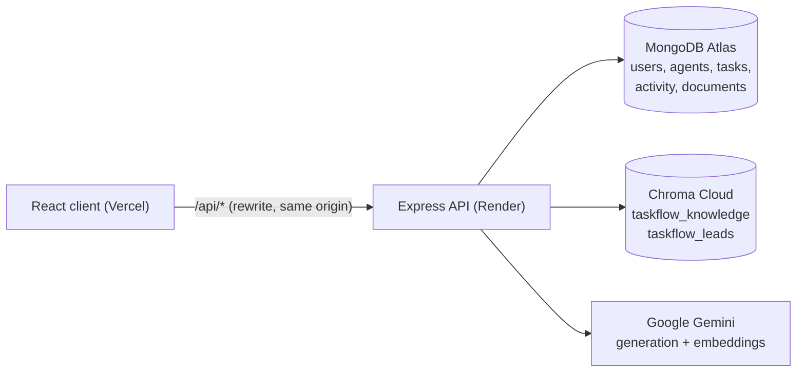

# TaskFlow Server

Backend API for **TaskFlow**, a lead-calling and task distribution platform for call-centre teams.
Managers import leads from CSV (or add them by hand), TaskFlow spreads them across agents, Gemini AI
categorizes them, and agents work through them: logging calls, scheduling callbacks and getting
AI-generated talking points grounded in the company's own documents.

**Frontend:** [TaskFlow_Client](https://github.com/Chirag-Tank1971/TaskFlow_Client)

---

## Features

**Leads and tasks**
- CSV import processed in the background, with live progress. Round-robin assignment to available agents.
- Create, edit and reassign single tasks. Auto-assign picks the available agent with the fewest open tasks.
- Bulk actions: change status, reassign, delete (up to 200 tasks at a time).

**Calling workflow**
- Log call outcomes: no answer, busy, call back, interested, converted, not interested, wrong number.
- Outcomes move tasks through the pipeline automatically. Converted, not interested and wrong number close the task.
- Scheduled callbacks with due and overdue tracking.

**Audit trail**
- Every change is recorded, with who made it and when: create, import, edit, status change, reassignment, call, AI categorization, delete and AI assist.
- Stored separately from tasks, so history survives deletion.

**AI (Google Gemini)**
- **Auto-categorization** of every lead: Support, Sales, Technical, Billing, Urgent or General.
- **Knowledge base (RAG):** upload PDF, DOCX, TXT or Markdown. Agents ask questions and get answers taken *only* from those documents, with numbered citations.
- **Call Assist:** talking points, likely objections and a next best action for a lead. It draws on the lead's history, similar leads that converted, and the knowledge base.
- **Data assistant (admins):** plain-English questions about the data ("show urgent tasks", "who has the most open tasks?"), answered with **read-only** database tools.
- **Resilient model use:** one shared rate budget, automatic retries, and fallback to other models when one is overloaded or out of quota.

**Security**
- The session JWT lives only in an HttpOnly cookie. Role-based access (admin, manager, agent) is enforced on the server.
- Helmet, rate limiting, an allowlist of permitted frontend origins, zod input validation, escaped search input, upload size limits, and one error handler for the whole server.

---

## Tech stack

| Area | Technology |
|---|---|
| Runtime / framework | Node.js 22, Express 4 |
| Database | MongoDB Atlas + Mongoose 8 |
| Vector database | **Chroma Cloud** (`chromadb` 3) |
| AI | Google Gemini via `@google/genai`: `gemini-2.5-flash` + fallbacks; `gemini-embedding-001` (768 dimensions) |
| Auth & security | jsonwebtoken, bcryptjs, cookie-parser, helmet, express-rate-limit, cors, zod |
| Files | multer, csv-parser, pdf-parse 2, mammoth (DOCX) |
| Tests | Vitest + Supertest |

---

## Architecture



**RAG pipeline**

```
Upload ─► extract text (pdf-parse / mammoth) ─► chunks of ~800 tokens with overlap ─► Gemini embeddings (768-d, normalized)
       ─► Chroma Cloud "taskflow_knowledge" (metadata: document, title, audience)

Question ─► embed the question ─► top-5 similar chunks (similarity ≥ RAG_MIN_SIMILARITY; agents only see "everyone" documents)
         ─► no match: "not in the knowledge base" (no generation request spent)
         ─► match: Gemini answers ONLY from those chunks, citing [1], [2] … ─► answer + sources
```

**Data assistant.** The model never writes database queries. It must choose one of six read-only tools
(`search_tasks`, `count_tasks`, `agent_workload`, `search_activity`, `upload_history`, `reply`). The
server validates the parameters with zod and builds a MongoDB query that reads only allowed fields
(never passwords), capped at 100 rows.

---

## Getting started

**Prerequisites:** Node.js **22.12+**, a MongoDB Atlas cluster, a Gemini API key, and a Chroma Cloud database.

```bash
git clone https://github.com/Chirag-Tank1971/TaskFlow_Server.git
cd TaskFlow_Server
npm install
cp .env.example .env        # then fill in the values (see below)
npm run chroma:check        # verifies the Chroma Cloud credentials end to end
npm run dev                 # http://localhost:5000 (auto-restarts on changes)
```

On startup you should see:

```
[Categorization] AI ready. Model: gemini-2.5-flash; fallbacks: …
[CORS] Allowed origins: …
Server running on port 5000
MongoDB Connected
[Chroma] ✓ Connected to Chroma Cloud (database "…") · taskflow_knowledge: N vectors (cosine) · …
```

**First admin account.** Public signup creates agents. An admin can register through the app only while no
admin exists yet (first-time setup). After that, create admins and managers from the command line:

```bash
npm run create:admin -- admin@company.com "a-strong-password" "Admin Name" admin   # or: manager
```

---

## Environment variables

See [`.env.example`](.env.example) for the full annotated list.

| Variable | Required | Description |
|---|---|---|
| `NODE_ENV` | ✓ | `production` on the server: secure cookies, strict origin check, proxy trust |
| `PORT` | | Defaults to 5000 (Render sets it) |
| `MONGO_URL` | ✓ | MongoDB connection string |
| `JWT_SECRET` | ✓ | Long random string used to sign sessions |
| `GEMINI_API_KEY` | ✓ | Google AI Studio key (**paid key recommended**, see below) |
| `ALLOWED_ORIGINS` | ✓ in production | Frontend address(es), comma-separated, e.g. `https://your-app.vercel.app`. `*` matches one part of a domain name. |
| `TRUST_PROXY` | | Number of proxies in front of the server (default 1 in production) |
| `CHROMA_API_KEY` / `CHROMA_TENANT` / `CHROMA_DATABASE` | ✓ for AI features | Chroma Cloud credentials. Database names are **case-sensitive**. |
| `ENABLE_AI_CATEGORIZATION` | | `false` disables Gemini categorization |
| `GEMINI_MODEL` | | Primary model (default `gemini-2.5-flash`) |
| `GEMINI_FALLBACK_MODELS` | | Comma-separated fallbacks, tried in order |
| `GEMINI_RPM` / `GEMINI_EMBED_RPM` | | Shared per-minute request budgets (defaults 5 / 90) |
| `RAG_MIN_SIMILARITY` | | Minimum relevance, 0–1, for a knowledge passage (default 0.6) |
| `MAX_UPLOAD_MB` / `MAX_KNOWLEDGE_DOC_MB` | | CSV / document size limits (defaults 5 / 10) |

Use a **separate Chroma database per environment** (e.g. `Task-flow-dev` locally, `Task-flow` in production).

---

## Scripts

| Command | What it does |
|---|---|
| `npm run dev` | Start with nodemon (auto-restart on changes) |
| `npm start` | Start for production |
| `npm test` | Run the Vitest suite (sets `NODE_ENV=test`; safe to run next to the dev server) |
| `npm run chroma:check` | Check Chroma Cloud: credentials, database access, write + search. Uses a throwaway collection. |
| `npm run create:admin -- <email> <password> "<name>" [admin\|manager]` | Create or promote an admin or manager |
| `npm run index:leads` | Add existing converted / not-interested leads to Chroma so Call Assist has examples. Safe to re-run. |
| `npm run migrate:categories` | One-time migration that adds category fields to old tasks |

---

## API reference

All endpoints are under `/api`. Authentication uses the HttpOnly `token` cookie set by login; a
`Bearer` header is also accepted for non-browser clients. Errors are JSON: `{ "message": "…" }`.

**Access levels:** *public*, *any* (any logged-in user), *mgr* (admin or manager), *admin*. "Own" means agents can only act on tasks assigned to them.

### Auth
| Method | Path | Access | Description |
|---|---|---|---|
| POST | `/auth/login` | public | Log in (sets the session cookie) |
| POST | `/auth/signup` | public | Register an agent (admin only during first-time setup) |
| GET | `/auth/me` | any | Current user |
| GET | `/auth/logout` | public | Clear the session cookie |

### Tasks
| Method | Path | Access | Description |
|---|---|---|---|
| GET | `/tasks` | any | List/search tasks (`category`, `status`, `search`, `agentId`, `page`, `limit`) |
| GET | `/tasks/:agentId` | any (own) | One agent's tasks |
| POST | `/tasks` | mgr | Create a task (auto-assign and AI category when not given) |
| PATCH | `/tasks/:taskId` | any (agents: own; notes + status only) | Edit, recategorize, reassign |
| POST | `/tasks/:taskId` | any (own) | Change status |
| DELETE | `/tasks/:taskId` | any (own) | Delete a task |
| POST | `/tasks/bulk/status` | any (own) | Bulk status change |
| POST | `/tasks/bulk/assign` | mgr | Bulk reassign |
| DELETE | `/tasks/bulk` | any (own) | Bulk delete |
| POST | `/tasks/:taskId/calls` | any (own) | Log a call (`outcome`, `note`, `callbackAt` for callbacks) |
| GET | `/tasks/:taskId/activity` | any (own) | The task's history |
| POST | `/tasks/:taskId/assist` | any (own) | AI Call Assist suggestions |

### Agents, uploads, analytics
| Method | Path | Access | Description |
|---|---|---|---|
| GET / POST | `/agents` | any / mgr | List / add agents |
| POST | `/agents/update` | mgr | Update an agent |
| DELETE | `/agents/:id` | mgr | Delete an agent and their tasks (logged in the audit trail) |
| GET | `/agent/stats\|performance\|activity/:agentId` | any | Per-agent statistics |
| POST | `/upload` | mgr | Upload a task CSV (`FirstName, Phone, Notes`); returns a `jobId` |
| GET | `/upload/progress/:jobId` | any | Import progress |
| GET | `/upload/stats`, `/upload/history`, `/upload/:id` | any | Upload statistics and history |
| GET | `/analytics/stats\|distribution\|trends\|performance\|recent` | any | Dashboard analytics |
| GET | `/activity` | mgr | Audit log (`type`, `actorRole`, `actorId`, `search`, `from`, `to`, `page`, `limit`) |

### AI
| Method | Path | Access | Description |
|---|---|---|---|
| POST | `/knowledge/documents` | mgr | Upload a document (`file`, `title`, `audience`: `all` or `managers`); indexed in the background |
| GET | `/knowledge/documents` | mgr | Documents, indexing status, and Chroma health |
| DELETE | `/knowledge/documents/:id` | mgr | Remove a document and its vectors |
| POST | `/knowledge/ask` | any | Ask the knowledge base: `{ question }` → `{ answer, answered, sources }` |
| GET | `/knowledge/queries` | mgr | Recent questions (`?unanswered=true` shows gaps in the documentation) |
| POST | `/data/ask` | mgr | Data assistant: `{ question, timeZone }` → a table, count or message |
| POST | `/categorization/task/:taskId`, `/categorization/bulk` | any | Re-categorize tasks |
| GET | `/categorization/stats\|categories\|health` | any | Categorization statistics and model status |

Other: `GET /health` (not under `/api`) returns `{ status: "ok" }` for uptime checks.

---

## AI quotas and model fallback

All Gemini calls (categorization, knowledge-base answers, Call Assist and the data assistant) go through
`services/geminiGenerate.js`:

- **One shared budget per minute** (`GEMINI_RPM`), so a big CSV import can't starve the chat features.
- **When a model is overloaded (503),** it retries briefly and then switches to the next model.
- **When a model is out of quota (429),** it skips that model (for an hour on a daily limit, or a minute on a per-minute limit) and tries the next one.
- **When every model is out,** users see a clear message, e.g. *"The AI's daily free quota is used up."*

**The free Gemini tier is very limited:** about 20 requests a day for `gemini-2.5-flash`. On the free tier, Google may
also use what you send to improve its products, and TaskFlow's prompts include customer notes. **Use a paid key in production.**

---

## Deployment (Render + Chroma Cloud)

1. **Render → New Web Service** from this repo, with build command `npm install` and start command `npm start`.
2. **Set the environment variables** from the table above, including `NODE_ENV=production`, `ALLOWED_ORIGINS` (your Vercel address) and the three `CHROMA_*` values.
3. **MongoDB Atlas → Network Access:** allow Render's outbound IP addresses, or `0.0.0.0/0` with a strong database password.
4. **After deploying:**
   - check the `[Chroma] ✓ Connected` line in Render's logs;
   - upload the knowledge-base documents;
   - run `npm run index:leads` once.

**Notes**
- **Run a single instance.** The rate limits, the list of skipped models, upload progress and background indexing live in the server's memory.
- **The free Render plan sleeps when idle.** Documents that were being indexed when the server stopped are marked *failed*, with a message to re-upload, on the next start.
- **The frontend forwards `/api/*` through Vercel,** so the session cookie counts as first-party in every browser (see the client README).

---

## Testing

```bash
npm test
```

64 tests covering authentication and roles, input validation, access control on tasks and calls, the audit trail,
the RAG helpers (chunking, file types, Chroma error handling, distance-to-similarity conversion), the
data assistant's read-only safety (unknown tools, operator injection, row caps) and Gemini retry/fallback
behaviour. No database or network access is needed: Gemini is stubbed, and database-dependent paths are covered by validation tests.

---

## Project structure

```
TaskFlow_Server/
├── script.js                 # App entry: security middleware, CORS, routes, error handler
├── config/
│   ├── db.js                 # MongoDB connection
│   └── chroma.js             # Chroma Cloud client, health check, startup log, error messages
├── constants/callOutcomes.js # Call outcomes → task status
├── controllers/              # Request handlers (auth, tasks, agents, upload, analytics,
│                             #   activity, knowledge/RAG, data assistant, categorization)
├── middleware/               # authenticate (JWT cookie), authorize (roles)
├── models/                   # User, Agent, Task (+ call logs), Activity, Upload,
│                             #   KnowledgeDocument, KnowledgeQuery
├── routes/                   # Express routers (see the API reference)
├── services/
│   ├── geminiClient.js       # Model chain, per-model quota tracking
│   ├── geminiGenerate.js     # Resilient generation (retries, fallback, budget)
│   ├── geminiRateLimiter.js  # Shared per-minute budgets
│   ├── categorizationService.js
│   ├── embeddingService.js   # Gemini embeddings (768-d, normalized)
│   ├── chunker.js            # Text → overlapping chunks
│   ├── knowledgeService.js   # Extract, index, search; recovery of interrupted indexing
│   ├── ragService.js         # Cited answers and Call Assist
│   ├── leadIndexService.js   # "Similar converted leads" index
│   ├── dataQueryTools.js     # Read-only tools for the data assistant
│   ├── dataAssistantService.js
│   ├── activityService.js    # Audit-trail writer
│   └── progressTracker.js    # CSV import progress
├── validators/               # zod schemas
├── utils/                    # multer config, regex escaping
├── scripts/                  # create:admin, index:leads, chroma:check, migrations
└── tests/                    # Vitest suites + shared helpers
```

---

## Troubleshooting

| Symptom | Fix |
|---|---|
| Login fails with **"CORS policy violation: Origin not allowed"** (403) | Add your frontend address to `ALLOWED_ORIGINS`. Render's logs show `[CORS] Rejected origin …` with the exact value to add. |
| `[Chroma] ✗ … can't access database "x"` | Use the exact database name the key can access (it's listed in the message). Names are case-sensitive. |
| "The AI's daily free quota is used up" | Wait for the reset (midnight Pacific time), add fallback models, or use a paid key. |
| Every task is categorized as "General" | AI is disabled or out of quota; see `GET /api/categorization/health`. |
| A document is stuck or failed | Delete it and upload again. Scanned (image-only) PDFs aren't supported. |

---

## Author

**Chirag Tank** · GitHub [@Chirag-Tank1971](https://github.com/Chirag-Tank1971) · chiragtank1971@gmail.com
