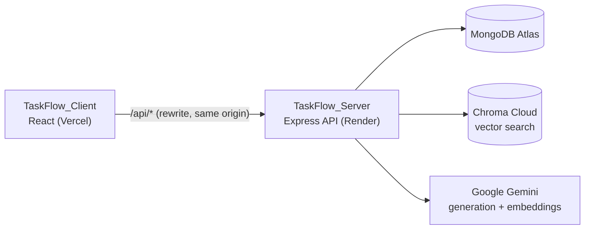

# TaskFlow

A lead-calling and task distribution platform for call-centre teams. Managers import leads from CSV,
TaskFlow spreads them across agents, Gemini AI categorizes them, and agents work through them: logging
calls, scheduling callbacks and getting AI-generated talking points grounded in the company's own documents.

This repository contains both halves of the app:

| Folder | What it is | Stack | Deployed on |
|---|---|---|---|
| [`TaskFlow_Client/`](TaskFlow_Client) | React frontend | React 19, Vite 8, Tailwind CSS 4, React Router 7 | Vercel |
| [`TaskFlow_Server/`](TaskFlow_Server) | REST API | Node.js 22, Express 4, MongoDB, Chroma Cloud, Google Gemini | Render |

Each folder has its own detailed README:
- [Client README](TaskFlow_Client/README.md): features, pages and roles, how it talks to the backend, Vercel deployment.
- [Server README](TaskFlow_Server/README.md): environment variables, API reference, RAG pipeline, AI quotas, Render deployment.

---

## Architecture



The client always calls `/api/...` on its own origin. In development Vite forwards those requests to
`http://localhost:5000`; in production `vercel.json` rewrites them to the Render backend. This keeps the
HttpOnly session cookie first-party in every browser.

---

## Running locally

**Prerequisites:** Node.js **22.12+**, a MongoDB Atlas cluster, a Gemini API key, and a Chroma Cloud database.

Clone the repo:

```bash
git clone https://github.com/Chirag-Tank1971/TaskFlow.git
cd TaskFlow
```

**1. Start the server** (terminal 1):

```bash
cd TaskFlow_Server
npm install
# create a .env file with the variables listed in TaskFlow_Server/README.md
npm run chroma:check        # optional: verifies the Chroma Cloud credentials
npm run dev                 # http://localhost:5000
```

**2. Start the client** (terminal 2):

```bash
cd TaskFlow_Client
npm install
npm run dev                 # http://localhost:3000
```

Open http://localhost:3000. The client needs no `.env` for local development.

**First admin account:** an admin can sign up through the app only while no admin exists yet. After
that, create admins and managers from the command line:

```bash
cd TaskFlow_Server
npm run create:admin -- admin@company.com "a-strong-password" "Admin Name" admin   # or: manager
```

---

## Deployment

Both services deploy from this one repository by setting a **root directory**:

| Service | Platform | Root directory | Build | Start / output |
|---|---|---|---|---|
| Client | Vercel | `TaskFlow_Client` | `npm run build` | `dist` (configured in `vercel.json`) |
| Server | Render | `TaskFlow_Server` | `npm install` | `npm start` |

On Render, set `ALLOWED_ORIGINS` to the Vercel address, or login fails with a CORS error. See each
folder's README for the full checklists.

---

## Testing

```bash
cd TaskFlow_Server
npm test
```

---

## Repository history

This repo was created by merging the former `TaskFlow_Client` and `TaskFlow_Server` repositories with
`git subtree`, so the full commit history of both is preserved.

---

## Author

**Chirag Tank** · GitHub [@Chirag-Tank1971](https://github.com/Chirag-Tank1971) · chiragtank1971@gmail.com
